

# GRIP-Fusion

### Roadside Camera–LiDAR 3D Perception for Intersection Safety

**A new intersection dataset** &nbsp;·&nbsp; **A roadside camera–LiDAR 3D detector** &nbsp;·&nbsp; **State-of-the-art on three public benchmarks**

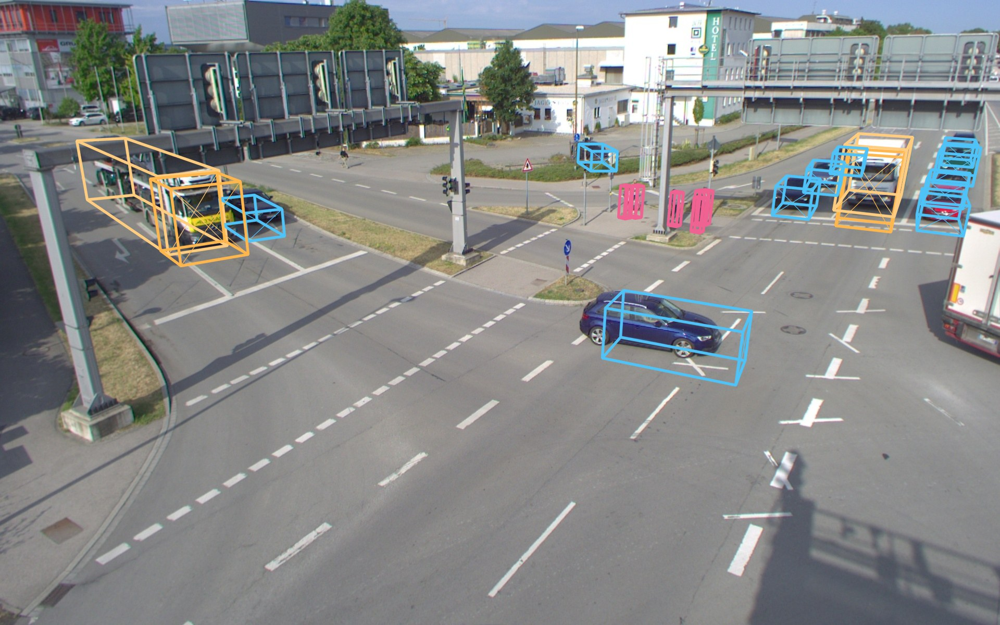

GRIP-Fusion 3D detections at the TUMTraf S110 intersection (one LiDAR + one camera).

---

## Highlights

- **New roadside intersection dataset** with synchronized LiDAR and camera recordings, 3D object annotations and traffic-conflict labels. Collection is finished and annotation is in progress.
- **GRIP-Fusion**: a roadside 3D detector that needs only **one LiDAR and one camera**. It outputs 3D boxes (position, size, heading, class) for downstream tracking and conflict analysis (TTC / PET).
- **State-of-the-art results** on TUMTraf V2X, TUMTraf Intersection and R-LiViT. Every baseline was re-trained and re-evaluated by us on the same split, with the same evaluator and the same input.

## News

- **2026-10** — Benchmark results on TUMTraf V2X, TUMTraf Intersection and R-LiViT released.
- **Coming** — Dataset release after annotation; code and models after publication.

---

## Dataset

> 🚧 **Data collection is complete and annotation is in progress.** Details will be updated here.

| Item | Description |
| --- | --- |
| Scene | Urban signalized intersection *(TBD: location / layout)* |
| Sensors | Roadside LiDAR + roadside camera(s), time-synchronized and calibrated *(TBD: models, mounting height)* |
| Scale | *(TBD: hours, sequences, frames)* |
| 3D annotations | 3D bounding boxes with class, heading and track ID *(TBD: classes)* |
| Conflict labels | Traffic-conflict events with TTC / PET *(TBD)* |
| Conditions | *(TBD: day / night / weather)* |

**What makes it different.** To our knowledge, no public roadside dataset provides traffic-conflict ground truth. Examples are TUMTraf, V2X-Seq, RCooper, R-LiViT and RESOLVE. Our dataset is designed for the full chain: roadside perception, then tracking, then conflict analysis. Its splits are sequence-level, so evaluation on unseen clips is not inflated by neighbouring training frames.

**Annotation pipeline.** *(TBD: tool, procedure and quality control.)*

---

## Performance

All numbers are on the official splits. Every method is trained and evaluated by us under the same protocol and the same evaluator. **Bold** is best; GRIP-Fusion always uses LiDAR + camera.

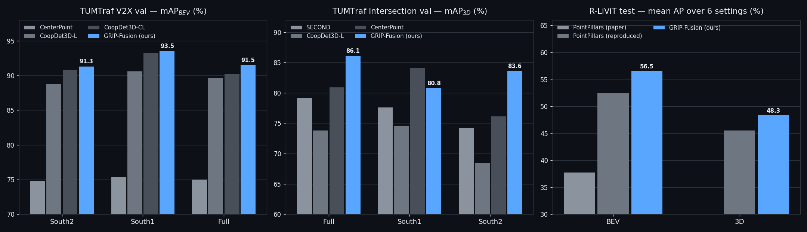

### TUMTraf V2X (val) — official mAPBEV (%)

| Method | Input | South 2 | South 1 | Full |
| --- | --- | :-: | :-: | :-: |
| PointPillars | 1 LiDAR | 77.7 | 62.3 | 70.9 |
| SECOND | 1 LiDAR | 74.4 | 63.6 | 68.0 |
| PV-RCNN | 1 LiDAR | 73.0 | 68.3 | 67.0 |
| CenterPoint | 1 LiDAR | 74.8 | 75.4 | 75.0 |
| CoopDet3D-L | 1 LiDAR | 88.8 | 90.6 | 89.7 |
| CoopDet3D-C | 3 cameras | 68.9 | 43.9 | 58.5 |
| CoopDet3D-CL | 1 LiDAR + 1 camera | 90.8 | 93.3 | 90.2 |
| CoopDet3D-CL | 1 LiDAR + 3 cameras | 91.2 | 93.4 | 90.5 |
| **GRIP-Fusion (ours)** | **1 LiDAR + 1 camera** | **91.3** | **93.5** | **91.5** |

### TUMTraf Intersection (val) — official mAP3D (%), 9 classes / 6 paper classes

| Method | Input | Full | South 1 | South 2 |
| --- | --- | :-: | :-: | :-: |
| PointPillars | 2 LiDARs | 76.7 / 72.3 | 77.1 / 72.5 | 74.4 / 66.7 |
| SECOND | 2 LiDARs | 79.1 / 76.1 | 77.6 / 74.1 | 74.2 / 66.4 |
| PV-RCNN | 2 LiDARs | 76.9 / 70.8 | 78.0 / 72.2 | 79.7 / 72.7 |
| CenterPoint | 2 LiDARs | 80.9 / 82.9 | **84.1 / 82.8** | 76.1 / 74.0 |
| CoopDet3D-L | 2 LiDARs | 73.8 / 81.8 | 74.6 / 81.0 | 68.4 / 73.0 |
| CoopDet3D-C | 2 cameras | 62.0 / 67.8 | 58.1 / 63.8 | 64.0 / 67.8 |
| CoopDet3D-CL | 2 LiDARs + 2 cameras | 58.7 / 59.2 | 60.0 / 59.6 | 61.3 / 62.2 |
| **GRIP-Fusion (ours)** | **2 LiDARs + 2 cameras** | **86.1 / 83.8** | 80.8 / 81.8 | **83.6 / 77.5** |

The point cloud is the registered south + north LiDAR cloud of the dataset; all methods use the same input. Scores come from the official TUMTraf dev-kit, with a fix for a score-misalignment issue in its prediction loader.

### R-LiViT (test) — official KITTI AP (R11, Easy), merged classes

| Method | Input | Type | Car @0.7 / 0.5 | Ped @0.5 / 0.25 | Cyc @0.5 / 0.25 |
| --- | --- | :-: | :-: | :-: | :-: |
| PointRCNN (paper) | 1 LiDAR | BEV | 28.3 / 31.6 | 4.6 / 5.2 | 11.8 / 13.1 |
| PV-RCNN (paper) | 1 LiDAR | BEV | 46.7 / 56.2 | 19.8 / 26.9 | 28.4 / 33.9 |
| PointPillars (paper) | 1 LiDAR | BEV | 46.7 / 58.4 | 23.1 / 30.6 | 30.1 / 37.6 |
| PointPillars (reproduced) | 1 LiDAR | BEV | 58.2 / 70.1 | 39.9 / 54.9 | 40.0 / 51.5 |
| **GRIP-Fusion (ours)** | **1 LiDAR + 1 camera** | BEV | **62.3 / 76.5** | **43.4 / 58.9** | **41.4 / 56.7** |
| PointPillars (reproduced) | 1 LiDAR | 3D | 38.2 / 67.2 | 30.7 / 54.7 | 32.2 / 50.1 |
| **GRIP-Fusion (ours)** | **1 LiDAR + 1 camera** | 3D | **39.1 / 73.2** | **31.6 / 58.7** | **32.3 / 55.1** |

Merged classes: motorcycles are counted as Cyclist; buses and trucks as Car. The R-LiViT paper reports BEV results only. RGB images exist for one in four LiDAR frames.

---

## Visualizations

### Camera view — TUMTraf V2X

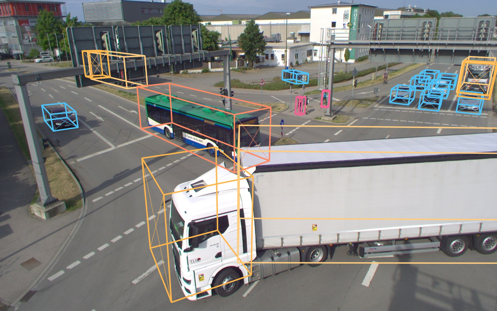
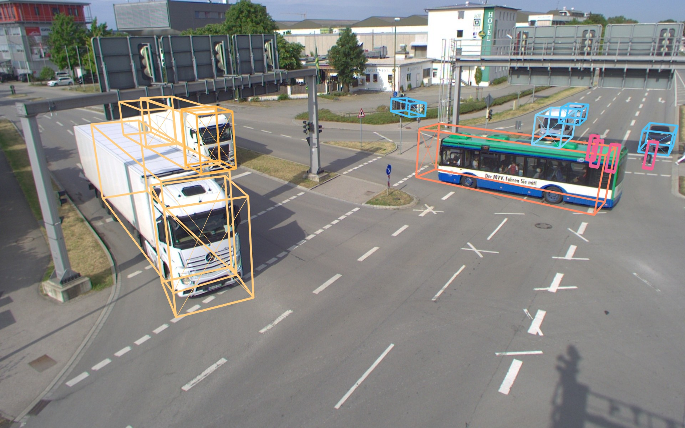

### Bird's-eye view — ground truth vs. CoopDet3D-CL vs. GRIP-Fusion

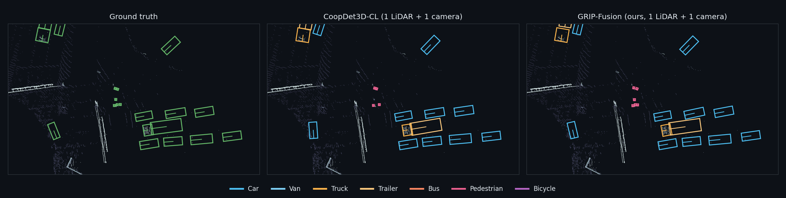
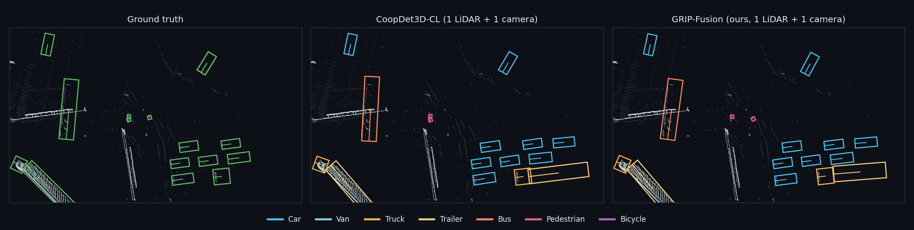
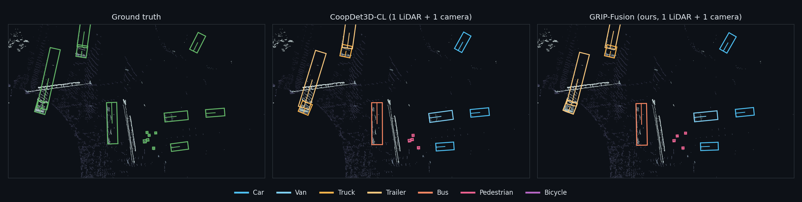

### R-LiViT — consecutive frames

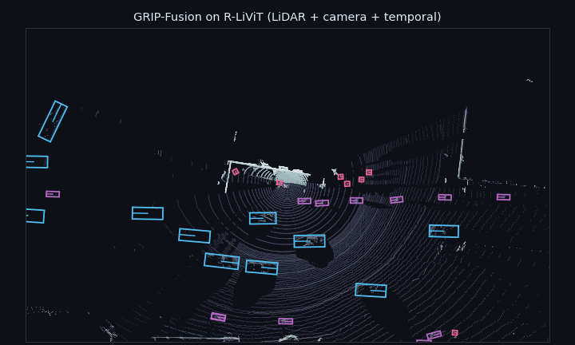

### R-LiViT — ground truth vs. GRIP-Fusion

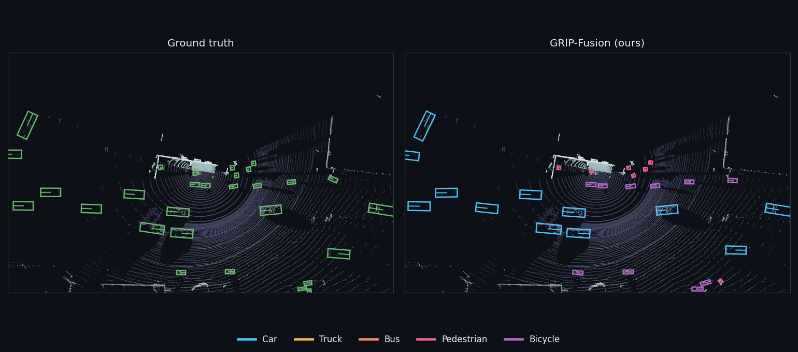
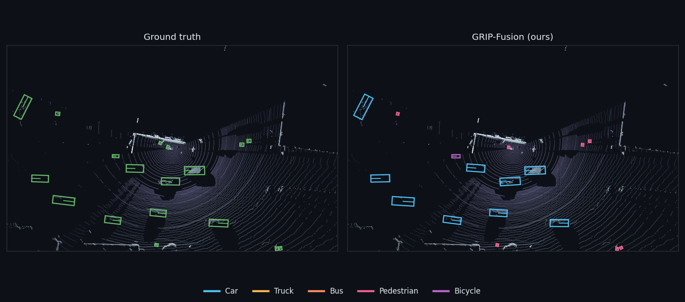
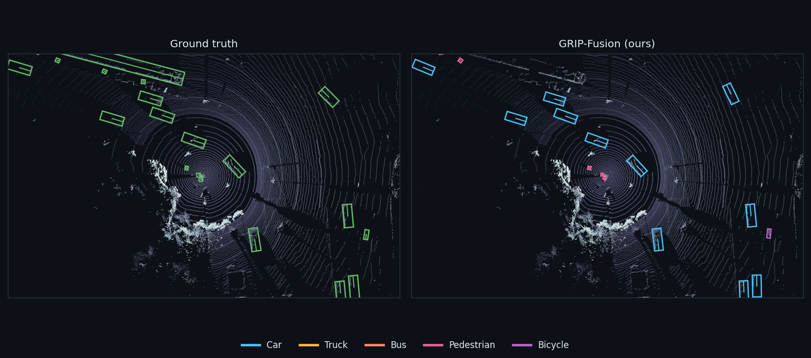

Colours: car / van (blue), truck / trailer / bus (orange), pedestrian (pink), bicycle (purple); ground truth in green. The short line inside each box marks its heading.

---

## Roadmap

- [x] Benchmark results on TUMTraf V2X, TUMTraf Intersection and R-LiViT
- [ ] Dataset annotation
- [ ] Dataset release and devkit
- [ ] Paper
- [ ] Code and pretrained models

## Acknowledgements

Benchmark results use the public [TUMTraf V2X and TUMTraf Intersection](https://github.com/tum-traffic-dataset/tum-traffic-dataset-dev-kit) datasets (CC BY-NC-ND 4.0) and the [R-LiViT](https://arxiv.org/abs/2503.17122) dataset. The visualizations show frames from these datasets for non-commercial research illustration, with credit to their authors. Baselines were trained with [OpenPCDet](https://github.com/open-mmlab/OpenPCDet) and [CoopDet3D](https://github.com/tum-traffic-dataset/coopdet3d).

## Citation

Coming soon.
